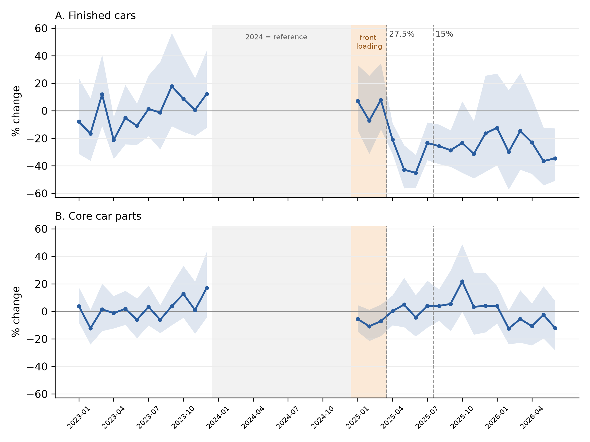

# Different responses to the 2025 US automotive tariffs

Replication code and data for **"Different Responses to the 2025 US Automotive Tariffs: Evidence from EU Exports of Finished Cars and Core Parts"**, submitted to the 19th FIW Research Conference on International Economics (Vienna, February 2027).

**Author:** Tahmina Zaman Mitoshi, University of Warsaw ([ORCID](https://orcid.org/0009-0000-9928-7774))

In April 2025 the United States raised the total tariff on EU cars from 2.5% to 27.5%, and from May it added 25% on a list of car parts, while most other EU goods paid an extra 10%. The paper uses monthly Eurostat customs data from January 2023 to June 2026 and a triple-difference Poisson (PPML) model. It compares each EU member state's exports of the same HS6 product to the United States and to other non-EU markets, relative to the same comparison for 629 machinery and transport products that faced only the general tariff.

## Main results

| | Estimate | 95% interval |
| --- | --- | --- |
| Cars, April to September 2025 | -30.3% | -40% to -19% |
| Core parts (engines, bodies, chassis, listed 8708 parts), April to September 2025 | +3.2% | -5% to +12% |
| Cars, US market only (against control products in the US) | -28.8% | -40% to -15% |
| Cars, China added to the comparison markets | -21.4% | |
| Declared price per car, weighted by 2023-24 flow value, April to July 2025 | -12.6% | -18.7% to -6.1% |
| Declared price per car, unweighted, April to July 2025 | -3.7% | -15.0% to +9.0% |

Permutation diagnostic: of 2,000 random groups of 17 control products, 22 show a US effect as negative as cars (p = 0.011); of 2,000 groups matched to the size of the car codes, none do (p = 0.0005).

Because 97.5% of US car imports from the EU are between related parties (US Census Bureau), the price results describe declared customs values, not who paid the tariff.



## Data

| Source | What | In this repository |
| --- | --- | --- |
| Eurostat Comext, monthly bulk files `full_v2_202301` to `full_v2_202607` ([download](https://ec.europa.eu/eurostat/api/dissemination/files/?sort=1&dir=comext%2FCOMEXT_DATA%2FPRODUCTS)) | EU exports and imports by member state, 8-digit product, partner and month | No (about 17 GB unpacked). The extracts built from them are included, see below |
| `7_processed_data/exports_ch84_87.parquet` | EU exports of HS chapters 84-87, exporter x CN8 x destination x month, Jan 2023 - Jun 2026; built by step05 | Yes |
| `7_processed_data/panel_v1.parquet` | Estimation panel, exporter x CN8 x destination x month with zeros filled; built by step20 | Yes |
| ECB euro reference rate, USD per EUR, monthly (series EXR.M.USD.EUR.SP00.A) | Converting euro values to dollars (step11) | Yes, `2_raw_data/ecb_exchange_rates` |
| US tariff legal texts (Federal Register) | Product lists of Proclamations 10908 (cars and parts) and 10984 (trucks), steel and aluminium derivative lists, Section 122 exemptions | Code lists extracted from the texts, `3_tariff_documents/*.csv`. The PDFs are on govinfo.gov |

Eurostat data are reused under the [Eurostat copyright notice](https://ec.europa.eu/eurostat/about-us/policies/copyright) (CC BY 4.0). Source: Eurostat, Comext database, downloaded October 2026. The two parquet files are derived from these data.

The product groups used in the paper are in `7_processed_data/hs6_groups_v4.csv`. `5_results/appendix_crosswalk.csv` maps every HS6 code to its group and its listing status in the US legal texts (paper, Appendix B).

## How to run

Requires Python 3.10 or newer (the results were produced with Python 3.14 on Windows and checked with Python 3.13 on Linux).

```bash
pip install -r requirements.txt
```

The scripts look for the project folder in `Downloads/FIW_2027_paper` in your home folder. To run them from a clone of this repository, set `FIW_BASE` to the clone:

```bash
export FIW_BASE=/path/to/eu-us-auto-tariffs-2025     # Windows PowerShell: $env:FIW_BASE = "C:\path\to\eu-us-auto-tariffs-2025"
cd 4_code
python step25_main_table.py
```

Each script prints its results and writes a file to `5_results` (or `5_figures`). The saved outputs from the paper are already in `5_results`, so you can compare your run with them; running a script overwrites its own output files.

**Starting from the raw Eurostat files.** Download the monthly bulk files, unpack them into `2_raw_data/eurostat_comext_extracted/` as `eurostat_exports_imports_YYYYMM.csv`, then run step02 to step05. Without the raw files, start at step06: the parquet files built by step05 and step20 are included.

## Scripts, in run order

The step numbers follow the author's research log; each script's first lines say what it does and what it saves.

| Scripts | What they do | Paper |
| --- | --- | --- |
| step02-step05 | Check the raw Comext files and confidential trade; build `exports_ch84_87.parquet` | Section 3.1 |
| step06-step11 | Cars counted in vehicles; car prices within exporter and code; prices in dollars | Section 4.4 background |
| step12-step19 | Product groups from the US legal lists: cars, core parts, uncertain codes, clean control; checks against the truck tariff and the steel and aluminium derivative lists | Section 3.2, Appendix B |
| step20 | Estimation panel (`panel_v1.parquet`) | Section 3.1 |
| step21-step25 | PPML estimates, monthly event study, seasonality and China checks, main results table | Sections 3.4, 4.1, 4.3 |
| step26-step30 | Border prices (weighted and unweighted), exporters, price segments, electric cars, exits | Sections 4.4, 4.5 |
| step31, step31b, step31c | Clustering checks and the first placebo runs (100 and 500 draws) | Section 4.2 |
| step32, step33 | Deflection to other non-EU markets and into the EU | Section 4.3, Table 1 |
| step34 | Tables and Figure 1 | Tables 1-5 |
| step35, step36 | Electric and plug-in cars; tariff regimes | Section 4.6, Table 6, Figure 3 |
| step37 | Variance estimators, pre-trend tests, comparison markets, control groups, size heterogeneity in prices, crosswalk | Sections 4.1-4.5, Table 2, Appendices B and C |
| step38b | Permutation diagnostic, 2,000 random and 2,000 size-matched draws (seeds 2027 and 2028), Figure 2 | Section 4.2, Figure 2 |
| step39 | Observations and clusters for Table 1; weight per car | Table 1, Section 4.4 |

`step38_placebo_parallel.py` is the first version of the placebo run; it uses too much memory on an ordinary PC and is kept only because its random draws are the same as those of step38b. Use step38b.

Run times on a laptop: most scripts take under 5 minutes; step37 about 7 minutes; step38b about 3.5 hours for both placebo rules with 2 worker processes (it saves every 10 draws and can be restarted).

## Repository structure

```
2_raw_data/ecb_exchange_rates/   ECB exchange rates
3_tariff_documents/              product codes extracted from the US legal texts
4_code/                          the scripts
5_results/                       saved results (CSV and text tables)
5_figures/                       Figures 1 and 2
7_processed_data/                product groups and the two parquet extracts
```

## Licence

Code: MIT licence (see `LICENSE`). Data derived from Eurostat: CC BY 4.0, with the source stated above.

## Citation

Mitoshi, T. Z. (2026). Different Responses to the 2025 US Automotive Tariffs: Evidence from EU Exports of Finished Cars and Core Parts. Paper submitted to the 19th FIW Research Conference on International Economics, Vienna.
